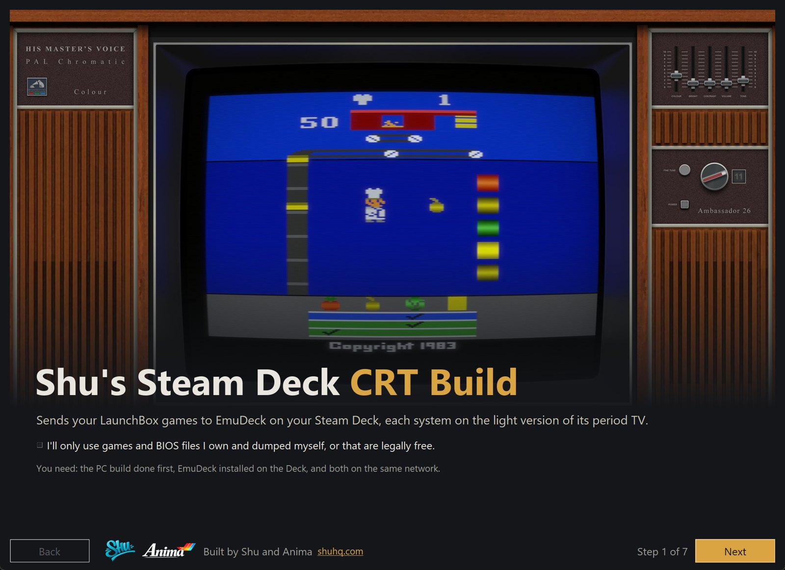
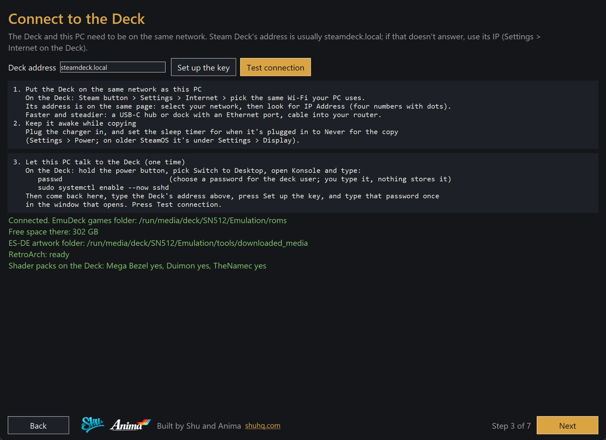
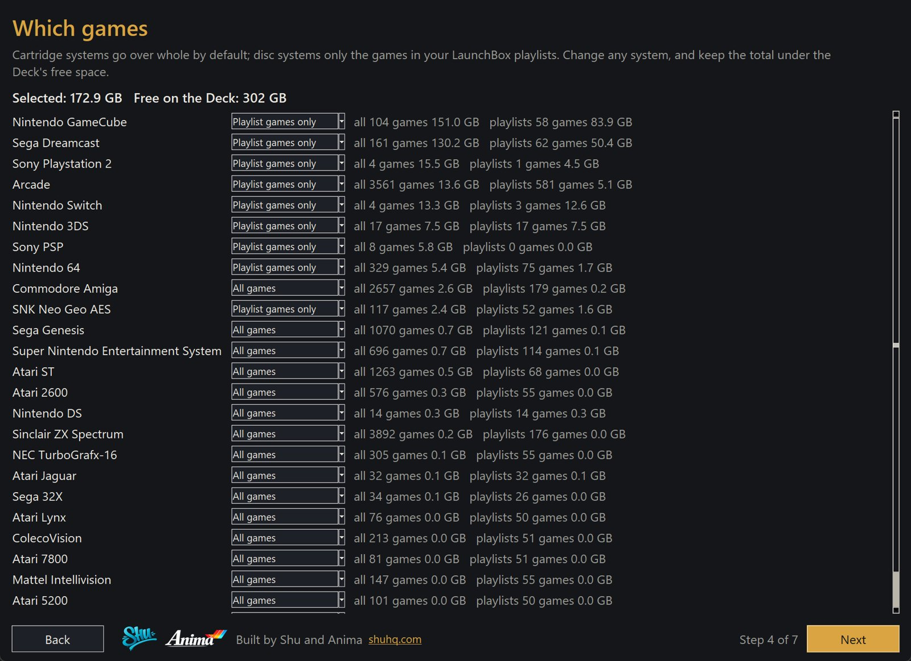

# Shu's Steam Deck CRT Build

The Steam Deck companion to [Shu's LaunchBox 4K CRT Build](https://github.com/shu2600/shus-launchbox-4k-crt-build).
It runs on your Windows PC and sends your LaunchBox library to EmuDeck on your Steam Deck over your home network, with
every system on the light version of the same period TV, monitor or handheld look your PC build uses.

**No games, BIOS or firmware are included, downloaded or linked. You bring your own.** See [DISCLAIMER.md](DISCLAIMER.md).

## Before you start

- The PC build done (it gives the Deck its library, looks and artwork).
- [EmuDeck](https://www.emudeck.com/) installed on the Deck, with RetroArch opened once.
- The Deck and your PC on the same network: Wi-Fi works, a USB-C hub with Ethernet is faster.

## Quick start

1. Download this repo (green Code button, Download ZIP) and unzip it anywhere on your PC.
2. Double-click **`setup_deck.bat`**. If Python isn't on your PC it offers to install it.

| Step | What happens |
|---|---|
| Welcome | What this is, and a tick to confirm you'll use your own games and BIOS |
| Your PC build | Where your LaunchBox and RetroArch are, or point it at your PC build's settings |
| Connect to the Deck | How to put the Deck on your network, turn on SSH (you set the Deck password yourself), add a key and test |
| Which games | Every system with its size: all games, playlist games only, or none, against the Deck's free space |
| Looks and extras | TV looks (Mega Bezel Standard), ES-DE artwork, Steam favourites with box art |
| Send to the Deck | Copies everything with a live log. Cancel stops it; running it again carries on |
| Finished | Where to find it all on the Deck |

| Connect | Which games |
|---|---|
|  |  |

## What it does on the Deck

- Games go into EmuDeck's roms folders, on the internal drive or the SD card, wherever EmuDeck put them.
- Missing shader packs (Mega Bezel, Duimon, TheNamec) are downloaded by the Deck itself from their official pages.
- Each system gets the Standard version of its PC look, as the core preset and the content-folder preset EmuDeck uses.
  Old presets are kept as `.bak_emudeck`.
- LaunchBox covers, 3D boxes, logos and screenshots go into ES-DE's media folder.
- Your LaunchBox favourites become Steam shortcuts with box art; the old shortcuts file is kept as a backup.

## Legal

Same as the PC build: you supply the games and BIOS, every third-party pack comes from its creator, and nothing of
theirs is redistributed here. Credits are in the PC build's [CREDITS.md](https://github.com/shu2600/shus-launchbox-4k-crt-build/blob/main/CREDITS.md).

Built by Shu and Anima · [shuhq.com](https://shuhq.com) · [Support Me On Patreon](https://www.patreon.com/cw/Shu2600)
